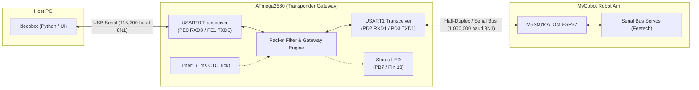
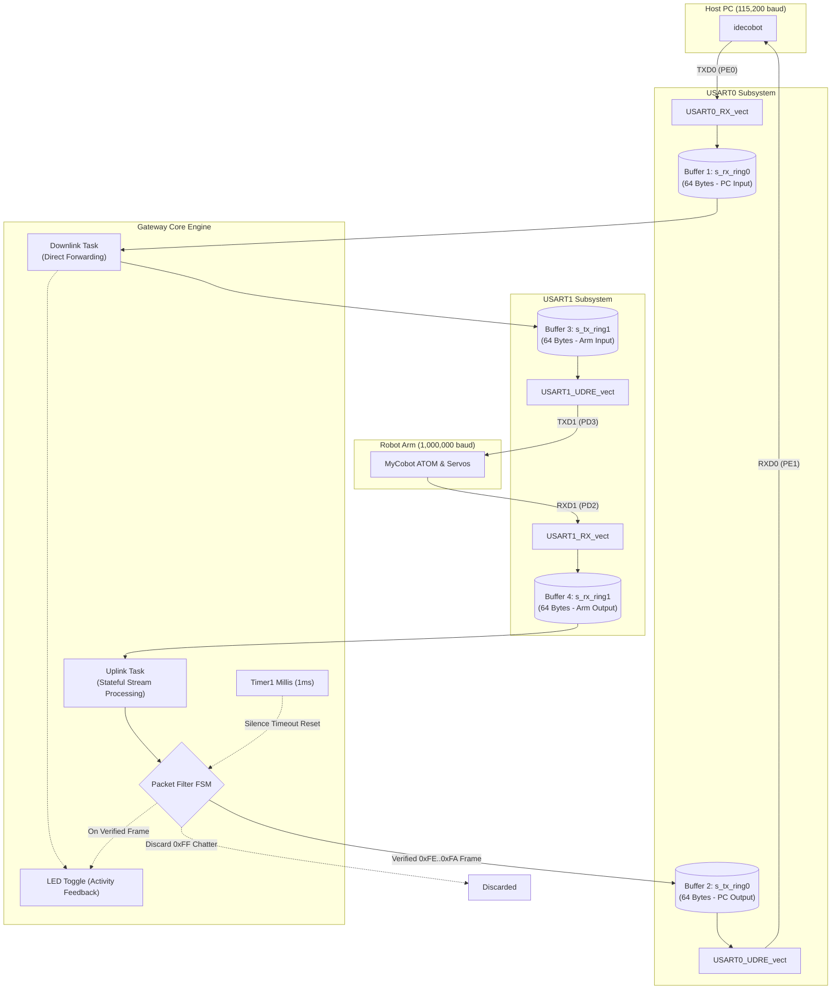
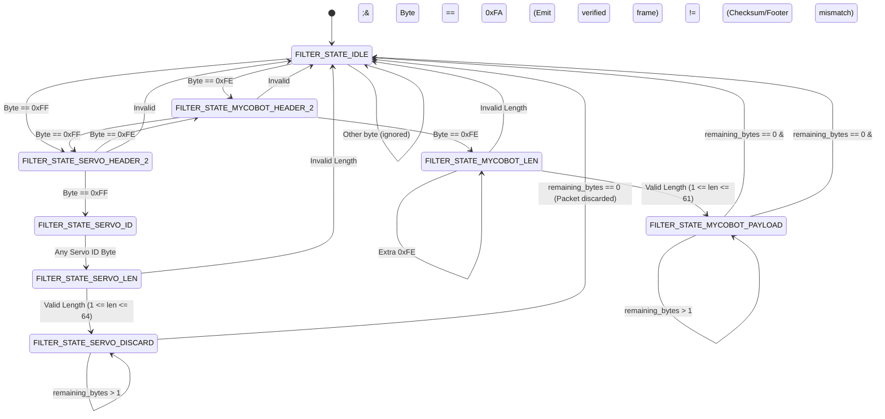
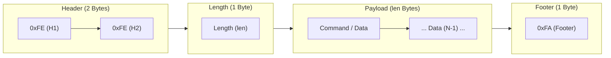
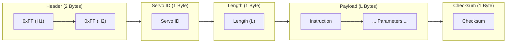
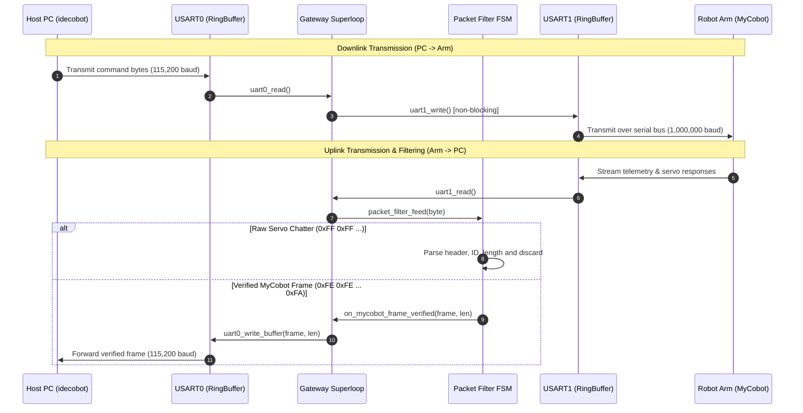

<p align="center">
  
</p>

# Transponder Firmware

> **High-Performance Serial Protocol Bridge & Packet Filter Firmware for ATmega2560**  
> Bridging **idecobot** (Host PC) with **mycobot** serial bus servo motors.

---

## 📌 Overview

**Transponder** is a dedicated real-time embedded bridge firmware designed for the **Microchip ATmega2560** microcontroller (Arduino Mega 2560). It acts as an intelligent communication gateway between the **idecobot** control environment running on a Host PC and the serial bus servo network of the **Elephant Robotics MyCobot** robotic arm.

### Key Capabilities

- **Baud Rate Translation**: Bridges standard Host PC communication at **115,200 baud** with high-speed robot arm serial communication at **1,000,000 baud** (1 Mbps).
- **Asymmetric Hardware Decoupling**: Uses a **4-ring-buffer FIFO architecture** (64 bytes each) with non-blocking, interrupt-driven USART transceivers to prevent buffer overrun and register tearing.
- **Intelligent Uplink Packet Filtering**: Integrates a deterministic finite-state machine (FSM) that forwards valid Elephant Robotics frames (`0xFE 0xFE ... 0xFA`) while filtering out and discarding raw Feetech servo bus chatter (`0xFF 0xFF ...`).
- **Precision CTC System Timebase**: Configures 16-bit **Timer1** in Clear Timer on Compare Match (CTC) mode for atomic, rollover-safe millisecond tracking and stream timeout resets.
- **Optical Diagnostic Failsafe**: Features a multi-mode error handler with optical LED pulse signaling on hardware faults.

---

## 🏗️ System Architecture

### Hardware Topology



---

## 🔄 Data Flow & 4-Buffer FIFO Architecture

The firmware decouples serial reception and transmission from superloop processing using four 64-byte FIFO ring buffers managed by interrupt service routines (`ISR`):



---

## 🔍 Packet Filter Finite-State Machine (FSM)

The uplink stream from the robotic arm carries both high-level Elephant Robotics responses and low-level servo bus chatter. The **Packet Filter** inspects incoming bytes in $O(1)$ constant time per byte:



### Protocol Frame Formats

#### 1. Elephant Robotics Frame *(Verified & Forwarded to Host PC)*



#### 2. Feetech Servo Bus Frame *(Filtered out & Discarded)*



---

## ⏱️ Communication Sequence



---

## 📂 Repository Structure

```
.
├── .clang-format               # LLVM-based code formatting configuration
├── .clangd                     # Clangd language server flags & relative include paths
├── docs/                       # Project documentation assets
├── README.md                   # Project documentation
├── transponder.code-workspace  # VS Code / Antigravity IDE workspace setup
└── sw/
    └── transponder/
        ├── main.c              # Firmware entry point & real-time superloop
        ├── build/              # Modular Makefile build system
        │   ├── Makefile        # Top-level build coordination
        │   ├── cflags.mk       # C compiler flags & include paths
        │   ├── subdir.mk       # Source lists & object build rules
        │   ├── tools.mk        # AVR toolchain executable definitions
        │   └── ...
        ├── core/               # Platform-agnostic application core
        │   ├── error_handler/  # Health monitoring, panic modes & optical blink codes
        │   ├── gateway/        # Bidirectional streaming & scheduling engine
        │   ├── interfaces/     # Architecture compatibility headers (progmem_compat.h)
        │   ├── packet_filter/  # Stateful protocol frame parser & chatter filter
        │   ├── protocol/       # Frame protocol definitions (0xFE, 0xFA, 0xFF)
        │   └── ring_buffer/    # Lock-free FIFO circular ring buffer implementation
        └── drivers/            # Hardware-specific peripheral abstraction (AVR)
            ├── led/            # PB7 (Pin 13) digital status LED driver
            ├── timer/          # 16-bit Timer1 CTC 1ms millisecond timebase
            └── uart/           # Hardware USART transceivers
                ├── uart0/      # USART0 transceiver (Host PC @ 115,200 baud)
                └── uart1/      # USART1 transceiver (Robot Arm @ 1,000,000 baud)
```

---

## ⚡ Hardware & Pinout Specifications

| Peripheral | MCU Pin | Arduino Pin | Configuration | Function |
| :--- | :--- | :--- | :--- | :--- |
| **USART0 RX** | `PE0` | Pin 0 (RX0) | Input, Interrupt-driven | Host PC Downlink Stream |
| **USART0 TX** | `PE1` | Pin 1 (TX0) | Output, Interrupt-driven | Host PC Uplink Verified Frames |
| **USART1 RX** | `PD2` | Pin 19 (RX1)| Input, Interrupt-driven | Robot Arm Raw Uplink Stream |
| **USART1 TX** | `PD3` | Pin 18 (TX1)| Output, Interrupt-driven | Robot Arm Downlink Forwarding |
| **Status LED** | `PB7` | Pin 13 | Digital Output | Heartbeat, Activity & Error Panic Pulses |
| **Timer1** | Internal | N/A | CTC Mode (OCR1A = 249) | 1.0 ms System Tick Generation |

### Baud Rate Calculations ($f_{CPU} = 16.000\text{ MHz}$)

Both USART peripherals operate in **Double Speed Asynchronous Mode** ($U2Xn = 1$):

$$\text{UBRR} = \left\lfloor \frac{f_{CPU}}{8 \times \text{BAUD}} - 1 + 0.5 \right\rfloor$$

- **USART0 (115,200 bps)**:
  $$\text{UBRR0} = \frac{16,000,000}{8 \times 115,200} - 1 = 17.36 - 1 \approx 16 \quad (\text{Error: } -2.12\%)$$
- **USART1 (1,000,000 bps)**:
  $$\text{UBRR1} = \frac{16,000,000}{8 \times 1,000,000} - 1 = 2 - 1 = 1 \quad (\text{Error: } \mathbf{0.00\%})$$

---

## 🚨 Error Handling & Optical Panic Codes

When fatal initialization errors occur, the system transitions to `SYSTEM_MODE_PANIC` and drives the board LED in a repeating optical diagnostic pulse pattern (blink count corresponding to the error code, followed by a 1-second pause):

| Error Code | Identifier | Description | Blink Count |
| :---: | :--- | :--- | :---: |
| `0x01` | `ERR_CODE_INIT_LED` | LED GPIO initialization failure | 1 |
| `0x02` | `ERR_CODE_INIT_UART0`| USART0 ring buffer / register init fault | 2 |
| `0x03` | `ERR_CODE_INIT_UART1`| USART1 ring buffer / register init fault | 3 |
| `0x04` | `ERR_CODE_INIT_FILTER`| Packet filter FSM init fault | 4 |
| `0x05` | `ERR_CODE_INIT_TIMER` | Timer1 CTC configuration failure | 5 |
| `0x0A` | `ERR_CODE_HARDWARE_FAULT` | Critical unrecoverable hardware fault | 10 |

---

## 🛠️ Build & Flash Instructions

### Prerequisites

Install the standard AVR development toolchain:

```bash
sudo apt-get update
sudo apt-get install -y gcc-avr avr-libc binutils-avr make avrdude
```

### Compiling

Navigate to the build directory and run `make`:

```bash
cd sw/transponder/build
make clean && make all
```

This produces:
- `transponder.elf`: Compiled ELF binary with debug symbols.
- `transponder.hex`: Intel HEX binary image ready for flash programming.
- `transponder.lss`: Extended assembly disassembly listing.
- `transponder.map`: Memory map detailing Flash and SRAM section allocation.

### Flashing to Target Board

Connect the Arduino Mega 2560 via USB and program using `avrdude`:

```bash
avrdude -v -p atmega2560 -c wiring -P /dev/ttyACM0 -b 115200 -D -U flash:w:transponder.hex:i
```

*(Replace `/dev/ttyACM0` with `/dev/ttyUSB0` depending on your serial interface).*

---

## 📄 License

Transponder is free software: you can redistribute it and/or modify it under the terms of the **GNU General Public License** as published by the Free Software Foundation, either version 3 of the License, or (at your option) any later version.

Copyright (C) 2026 Vladimir Roncevic `<elektron.ronca@gmail.com>`.

